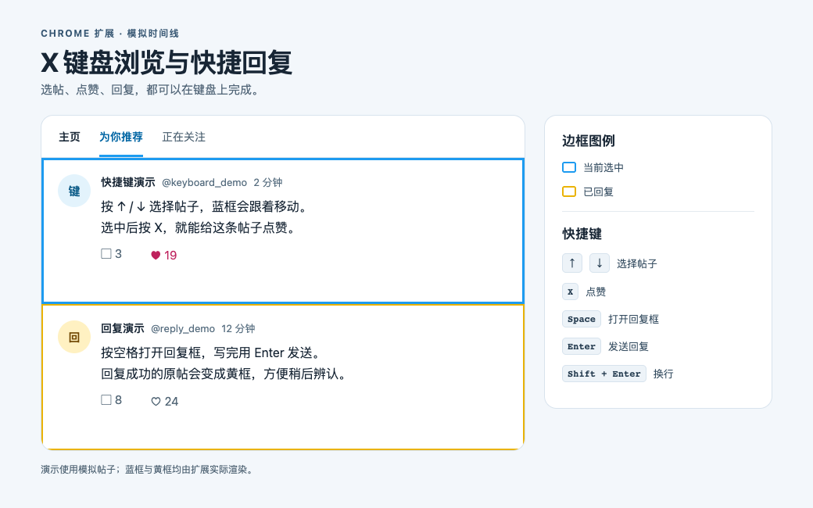

# X 键盘浏览与快捷回复

一个面向桌面 Chrome 的扩展。在 [X 首页](https://x.com/home) 用方向键选帖，按 `X` 点赞，按空格打开原生回复框，写完按 `Enter` 发送。回复过的帖子会留有黄框，再刷到时一眼就能认出来。

[下载最新版](https://github.com/gshota666/x-keyboard-reply/releases/latest) · [安装步骤](#安装) · [快捷键](#快捷键)



*演示使用模拟帖子，边框由扩展实际渲染。*

## 安装

无需构建或安装依赖。

1. 在 [Releases](https://github.com/gshota666/x-keyboard-reply/releases/latest) 下载 `x-keyboard-reply-v*.zip` 并解压。
2. 在 Chrome 地址栏打开 `chrome://extensions/`，开启右上角的「开发者模式」。
3. 点击「加载已解压的扩展程序」，选择解压得到的 `x-keyboard-reply` 文件夹（包含 `manifest.json`）。
4. 刷新 X 首页，按一次 `↓`。看到粗蓝框就可以开始使用。

**更新：** 将新版本解压覆盖原安装目录中的文件，在 `chrome://extensions/` 点扩展卡片上的 ↻，再刷新 X。也可直接加载仓库源码目录。[Chrome 官方安装说明](https://developer.chrome.com/docs/extensions/get-started/tutorial/hello-world#load-unpacked)

## 快捷键

| 按键 | 动作 |
| --- | --- |
| `↑` / `↓` | 选中上一条或下一条推文，自动滚到可见位置。首次按键从当前屏幕开始选。 |
| `X` | 点赞当前选中的推文，已点赞的保持原样。 |
| `Space`（空格） | 打开选中推文的 X 原生回复框，并聚焦输入区。 |
| `Enter` | 在回复框里发送回复。 |
| `Shift + Enter` | 换行。 |
| `Esc` | 交给 X 处理关闭弹窗或草稿提示。 |

浏览快捷键只在 X 首页生效，不会抢占输入框的按键。中文输入法组字、`@用户` 候选项和空回复不会触发快捷发送。

## 回复后会发生什么

提交回复后，弹窗一关就把原帖顶部对齐到导航栏下方，时间线顺序不变。X 确认发送成功后，原帖显示**黄框**；选中黄框帖子时，左侧仍有蓝色标记。

黄框会在刷新后保留。扩展只记录使用期间在该浏览器里确认成功的回复，不补标旧评论。

## 权限与本地数据

- **站点范围：** `https://x.com/*`，用于识别首页时间线和 X 的原生回复弹窗。
- **本地存储：** 只在当前 Chrome 配置中保存已回复的原帖 ID，不保存评论正文，也不调用额外网络接口。

## 开发与测试

源码是原生 JavaScript 和 CSS，无构建步骤。测试会在独立 Chromium 配置中加载真实扩展，用本地模拟时间线检查选帖、点赞、回复、输入法事件、长帖定位与黄框持久化，不使用真实 X 账号。

安装 Node.js 后，可运行：

```bash
bash tests/run-smoke.sh --install-browser  # 首次运行
bash tests/run-smoke.sh                    # 浏览器已安装时
```
